  I build thoughtful, maintainable web experiences and business applications — from polished interfaces to the systems that power them.

  <a href="https://rahat-chowdhury.vercel.app">Portfolio</a> ·
  <a href="https://www.linkedin.com/in/chowdhuryrahat/">LinkedIn</a> ·
  <a href="https://github.com/asadullahchowdhury">GitHub</a>

---

## About Me

I'm a Full-Stack Developer at **Codevioso** with **5+ years of experience** in web development. I build SaaS products, dashboards and business platforms end to end, from the database and APIs to the interface people use every day.

I started on the frontend and grew into a Frontend Lead before moving to the full stack, so I care about both sides: interfaces that feel clear and reliable, and code the next person can read and extend.

- **Current focus:** Full-stack SaaS and business platforms
- **Frontend:** Angular, React, Vue.js, Next.js, Nuxt.js
- **Backend:** PHP, Laravel, Node.js
- **Styling:** Tailwind CSS, Bootstrap, SCSS
- **Databases:** MySQL, MongoDB
- **Also use:** TypeScript, JavaScript, Git, Docker, Figma, GSAP, Linear
- **AI workflow:** Claude (Claude Code), ChatGPT and Gemini for refactoring, tests, code review and research. I own the architecture and review every change.

I'm open to connecting about full-stack roles, product work, and freelance collaborations.

## Tech Stack

  

## Selected Projects

### [Barberly](https://barberly.thethemeai.com/)
A barbershop booking and management platform. Worked with **Vue.js, Laravel (PHP), and Bootstrap** across the application.

### [Signmein](https://signme.thethemeai.com/)
A Laravel and Vue.js single-page application featuring CRUD workflows and a MySQL database.

### [Arrow](https://arrow.thethemeai.com/)
A web project included in my portfolio.

### Hotel Blue Castle · Farmasale · Saudagar 
Additional projects I've worked on. More public case-study details can be added when links and shareable project descriptions are available.

### Equidesk
I contribute to a client-facing business platform in a professional team environment. Project details and links are confidential, so I don't share internal information publicly.

> Some work is client-owned or private. This section only includes details suitable for a public profile.

## What I Value

- Clean, maintainable, and reusable code
- Accessible, responsive, user-focused interfaces
- Practical problem-solving and thoughtful implementation
- Clear communication and collaborative teamwork
- Continuous learning and improving how products are built

## Connect With Me

  
  
  
  

  <em>Thanks for stopping by. Feel free to explore my work or reach out to connect.</em>

